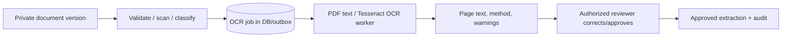
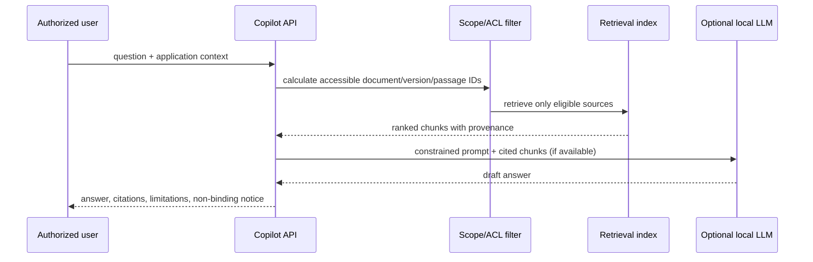

# AI/ML Architecture

## Safety boundary

## Step 3.1 OCR pipeline boundary

## Step 4 grounded retrieval boundary

Approved guidance retrieval is now backed by persisted `guidance_passages`, each pinned to its approved source version, approved extraction run, private document version and original page. Indexing rejects draft/unapproved source or extraction states and supersedes prior active passages before a rebuild. This host has no configured embedding model/vector extension, so results are explicitly `LEXICAL_FALLBACK_NO_EMBEDDING_MODEL`; this is not represented as semantic retrieval or LLM output. All result text rechecks private-document access.

Guidance ingestion uses `pypdf` for per-page embedded text and `pypdfium2` only to render individual low-text PDF pages for OCR fallback. PNG/JPEG inputs are decoded with Pillow and sent to the explicitly configured Tesseract executable through `pytesseract`; the application remains startable when that executable is absent. Each page records `EMBEDDED_TEXT`, `OCR_PDF_RENDER`, or `OCR_IMAGE`, warnings and immutable source-version/run provenance. Extraction is never an approval decision: an authorized reviewer must approve the run, and corrections preserve raw machine text while appending a correction revision. No embeddings, retrieval or LLM processing is included in this increment.

AI features are assistive only. They produce extracted text, similarity candidates, cited summaries, and flags with provenance and confidence. They cannot call transition, decision, assignment, notification, or update endpoints; use a read-only retrieval service; and never alter the official application state. A human with applicable backend permissions must review and explicitly confirm any evidence mapping or business action.

## OCR-to-evidence pipeline

The upload remains the source of truth. OCR stores per-page output, engine/method metadata, warnings and a corrected-text revision. Extraction does not create requirement mappings. Low-confidence extraction, unsupported file type, or worker failure leaves a retryable/manual-review task and does not block access to the original document.

## Retrieval-augmented Copilot

ACL filtering occurs **before** vector/similarity retrieval and citations are filtered again before response. The prompt instructs the LLM to use only supplied evidence, identify uncertainty, and refuse to state an approval/rejection/legal conclusion. Responses include source-version citations, model/embedding/OCR versions, request context, and a feedback control.

## Components and data

| Component | Data in | Data out | Controls |
|---|---|---|---|
| OCR worker | authorized document version via storage adapter | extraction pages/blocks/confidence | file type/size limits, isolated process/container, retry/dead-letter status |
| Embedding worker | sanitized text chunks and source metadata | vectors + chunk IDs/version IDs | no vector is retrievable without source ACL lineage |
| Retriever | user/application context, query | ranked accessible chunks | metadata ACL filter, source/version filters, top-k caps, request audit |
| Optional LLM adapter | question + retrieved text | non-binding answer | feature flag, timeouts, no tools, local endpoint only when installed, output guardrails |
| Copilot ledger | prompt hash/context/citations/result metadata | reviewable interaction history | redact sensitive logging; normal retention/access controls |

## Grounding, quality, and offline behavior

- The initial corpus is approved/versioned reference documents and records accessible to the requester. Unverified or synthetic handbook content is labelled in both retrieval and response.
- An answer with insufficient evidence states that it cannot establish the point and lists what source/evidence is missing. It does not fill gaps from model memory.
- Deterministic templates handle summaries when the LLM is disabled. Users can browse source passages directly.
- Evaluation uses a synthetic, labelled question set: citation precision, ACL leakage attempts, unsupported-claim rate, OCR character/field accuracy, retrieval recall, latency, and human acceptance/rejection rate.
- Prompt injections in uploaded documents are treated as untrusted content. The system uses document delimiters, ignores embedded instructions, and never exposes tools/credentials to the model.

## Model lifecycle

Pin OCR, embedding, and LLM model identifiers plus application code version in every generated artifact. Re-indexing creates a new embedding collection/version; it does not overwrite provenance. Before changing a model, run the synthetic evaluation suite, security tests, and a human-review comparison. Model outputs and source text follow the same access, retention, deletion/legal-hold policy as their source records.
