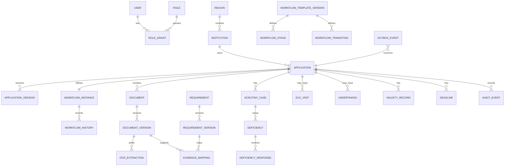

# Database Design

## Data principles

PostgreSQL is authoritative. Tables use UUID primary keys, UTC `timestamptz`, `created_at`, `created_by`, `updated_at`, `updated_by`, a non-null `row_version` on mutable aggregates, and explicit `status` enums/check constraints. Soft deletion is limited to configuration/reference entities; official records are retained and superseded, never silently overwritten. JSONB is reserved for versioned structured configuration, processor payloads, and opaque provider metadata—not core relationships.

## Entity relationships

An institution owns applications; an application owns versioned submission data, a single workflow instance, and related records. Evidence links pin both requirement and document versions so a later update cannot rewrite past interpretation.

## Tables by aggregate

| Aggregate | Principal tables | Important constraints/indexes |
|---|---|---|
| Identity/scope | `user`, `role`, `permission`, `role_grant`, `institution`, `region`, `membership`, `session`, `refresh_token_family` | unique email/subject; role grant unique on principal/role/scope tuple; index active grants by user/scope |
| Application | `application`, `application_version`, `application_participant`, `submission_snapshot` | application number unique when assigned; one current version; index institution/status/updated; submitted snapshot immutable |
| Workflow | `workflow_template`, `workflow_template_version`, `workflow_stage`, `workflow_transition`, `workflow_prerequisite`, `workflow_instance`, `workflow_history` | unique template/version; unique stage key/template version; one active instance/application; history ordered by sequence |
| Documents | `document`, `document_version`, `document_acl`, `storage_object`, `document_access_log` | SHA-256 indexed; unique document/version; storage key unique; no public URL; ACL indexes subject/document |
| Scrutiny | `scrutiny_case`, `scrutiny_assignment`, `scrutiny_review`, `review_finding`, `deficiency`, `deficiency_response` | active assignment constraints; open deficiency index by application/due date; status transition check |
| Rules/evidence | `source_document`, `source_document_version`, `handbook_passage`, `requirement`, `requirement_version`, `applicability_rule`, `evidence_mapping` | source/checksum/version unique; mappings unique requirement-version/document-version/claim context |
| EVC/review | `evc_queue_item`, `evc_visit`, `evc_assignment`, `evc_observation`, `evc_outcome`, `panel_review_assignment`, `panel_review_record` | prevent overlapping member visit assignment; schedule/region indexes; participant role uniqueness |
| Compliance | `undertaking`, `undertaking_evidence`, `undertaking_verification`, `validity_record`, `renewal_request` | date/status indexes; provenance required for validity date; current validity unique per application/type |
| Notifications | `deadline_policy_version`, `deadline`, `notification`, `notification_delivery_attempt`, `escalation`, `outbox_event`, `job_execution` | idempotency unique keys; pending/next_attempt indexes; outbox unprocessed index; no dependency on Redis state |
| AI/audit/ops | `ocr_job`, `ocr_extraction`, `embedding_document`, `copilot_interaction`, `copilot_citation`, `audit_event`, `export_request`, `synthetic_scenario_run` | AI interaction/citation ACL lineage; audit append-only sequence/correlation indexes |

## Key record shapes

### Application and workflow

`application`: `id`, `institution_id`, `route_template_version_id`, `status_projection`, `current_version_id`, `row_version`.

`application_version`: normalized applicant data snapshot plus `version_number`, `submitted_at`, `submitted_by`, and checksum. Submitted content is write-protected.

`workflow_transition`: `from_stage_key`, `to_stage_key`, `authorized_role_keys`, `prerequisite_definition`, `block_definition`, `source_reference`, `escalation_policy_key`. `workflow_history` stores evaluated facts/reasons, actor, comment, and correlation ID—not executable code.

### Documents and evidence

`storage_object` stores opaque adapter key, byte size, SHA-256, content type, encryption metadata reference, quarantine state, and no public URL. `document_version` points to it and captures classification and supplied/verified metadata. `evidence_mapping` stores `PROPOSED|CONFIRMED|REJECTED`, rationale, confirmer, and model/OCR provenance where applicable.

### Audit/outbox immutability

`audit_event` is insert-only to the application database role used by the API. It contains actor/principal snapshot, action, resource type/id, policy decision, redacted before/after summaries, request/correlation IDs, IP/user-agent policy fields, and a hash chain (`previous_hash`, `event_hash`) per logical stream. Database permissions deny update/delete to runtime roles; an archival/export process can periodically verify chains. “Immutable-style” accurately describes this operational control; it is not a claim of cryptographic impossibility of privileged database alteration.

`outbox_event` includes event type/version, aggregate ID/version, idempotency key, JSON payload with minimum identifiers, `available_at`, `claimed_at`, `processed_at`, attempt count, and error. It is inserted in the same transaction as the source change.

Phase 3 migration `0003_scrutiny_lifecycle` implements the foundation subset: reviewer-owned `scrutiny_reviews`, immutable structured `scrutiny_findings`, stable synthetic `deficiencies`, and append-only `deficiency_responses`. It does not yet claim the full assignment, deadline, or statutory-review schema shown above.

## Referential integrity and lifecycle rules

- Foreign keys use `RESTRICT` for versioned/official records; deleting a referenced rule/document version is impossible.
- New document/application/template versions supersede old versions; references retain old IDs.
- `CHECK` constraints enforce valid date ranges (`expires_at >= effective_at`) and normalized deadline severity.
- Partial unique indexes ensure one active workflow instance/application and one active outbox claim worker lease.
- Row-level security may be evaluated as a defense-in-depth later, but the Phase 2 base design enforces scope in the application service and test suite to keep policy explainable.

## Migration and backup approach

Alembic revisions are reviewed, forward-only, and include data migrations separately from schema migration where necessary. Before production, define encrypted backup cadence, restore objectives, retention/legal-hold requirements, and restore drills. Development seeds only labelled synthetic data through the Validation Center.

## Implemented guidance catalogue subset

## Private guidance extraction provenance

## Guidance passage index

Migration `0012_guidance_passages` adds durable chunks linked to exact source/version, extraction run/page and private document/version. Rows record hash, chunking/index version, embedding availability metadata, eligibility provenance and active/superseded state. It is an additive PostgreSQL-targeted migration; vector storage is deliberately deferred until a supported runtime is provisioned.

Migration `0010_guidance_ocr` adds nullable immutable source-file links on `guidance_source_versions`, `guidance_extraction_runs`, and `guidance_extraction_pages`. Each run records the source/document/version IDs, attempt number, file hash, extractor/configuration identity, lifecycle timestamps, warnings/failure category and reviewer decision. Pages retain raw text separately from any reviewer correction and include method, optional confidence and quality metadata. These are restricted derived records: read access is checked against the linked private document in addition to guidance permission. The migration targets PostgreSQL; it has not been validated on a real PostgreSQL instance, and the historical SQLite limitation at `0006` remains unchanged.

Migration `0009_guidance_catalogue` adds the prototype's actual catalogue tables: `guidance_sources`, immutable-by-API `guidance_source_versions`, `catalogue_requirements`, and `requirement_evidence_mappings`. A guidance version has a stable source identity, version number/label, optional effective date/content hash/upload metadata, lifecycle status, verification label, creator, reviewer and review timestamp. `VERIFIED_OFFICIAL` remains a review decision; an upload or metadata record alone never makes a source official.

Requirements are versioned under a stable identifier and pin a guidance version, category, module, optional section reference, applicability/evidence metadata and lifecycle provenance. A replacement may supersede a previous requirement version, but historic mappings retain the original requirement ID.

Mappings pin one requirement version to one private document and exact document version plus an application context. Optional EVC/compliance link IDs must resolve to that same document/version and application. `PROPOSED`, `CONFIRMED`, `REJECTED`, and `SUPERSEDED` are persisted states; a confirmed replacement supersedes its reviewed predecessor rather than altering it. Mapping records are not proof of compliance and do not alter workflow state. OCR text, passages, vectors, and LLM artifacts are intentionally not present in this migration.
