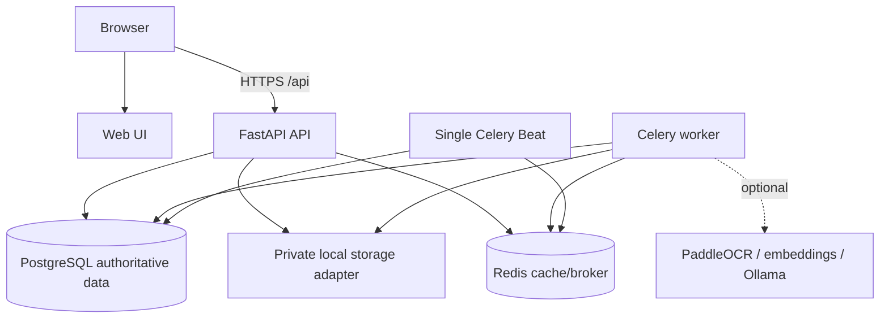
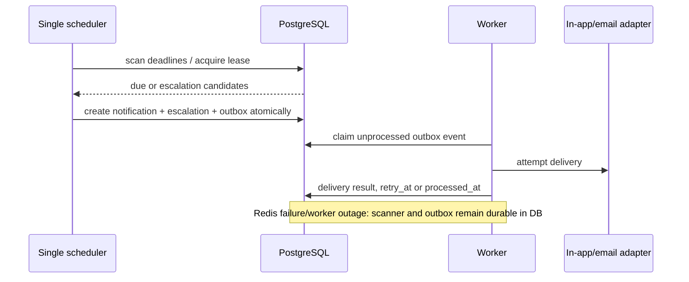

# Deployment and Operations Architecture

## Local development topology

## OCR runtime requirements

The API dependency set includes `pypdf`, Pillow, `pypdfium2` and `pytesseract`. `pypdfium2` provides PDF rendering through its Python wheel; it does not execute uploaded content. OCR additionally requires a locally installed Tesseract executable configured with `OCR_EXECUTABLE_PATH` (for example `C:\Program Files\Tesseract-OCR\tesseract.exe` on Windows, or `/usr/bin/tesseract` on Linux). Production workers must set page, byte, pixel and timeout limits (`MAX_OCR_PAGE_COUNT`, `MAX_OCR_INPUT_BYTES`, `MAX_OCR_IMAGE_PIXELS`, `OCR_TIMEOUT_SECONDS`) and run with access only to the private storage volume. If Tesseract is absent, OCR-required jobs fail with `OCR_EXECUTABLE_NOT_FOUND`; the application continues to serve non-OCR work.

Docker Compose runs six services: `web` (Vite development server or built static host), `api` (FastAPI), `worker` (Celery), `scheduler` (the sole Celery Beat instance), `postgres`, and `redis`. A private local storage volume is mounted only into API/worker; it is not mounted into the web service. Optional OCR/model services remain local/feature-flagged and are not prerequisites for core startup.

The web client cannot reach Postgres, Redis, the document volume, or AI services. In a production-shaped deployment, replace local storage with a private object-storage adapter, terminate TLS at an approved ingress, use managed Postgres/backups, and place all internal services on private networks. No Kubernetes requirement exists for the prototype.

## Deadline detection and notification delivery

Deadline policy evaluation is always driven from PostgreSQL. A policy version calculates deadlines when a stage/deficiency/undertaking is created or changes. The scanner catches records due after its last successful checkpoint and is idempotent using policy/deadline/action keys. In-app notification records are visible even if email/SMS delivery fails. Channel choice and escalation recipients remain configurable and are not assigned statutory meaning.

## Health, logging, and diagnostics

- `GET /health/live`: process alive; no dependency probe.
- `GET /health/ready`: verifies migrations/current DB access, storage adapter access, Redis reachability as a degraded/noncritical signal, and reports AI availability separately.
- Structured JSON logs contain timestamp, level, service, event, trace/correlation IDs, aggregate IDs, job IDs and redacted error class. Never log tokens, raw documents, passwords, or full prompts unless a sanitized diagnostic policy permits it.
- Metrics track request latency/error rate, database/outbox backlog age, worker success/retry/dead-letter count, deadline scan lag, notification success, storage errors, OCR/AI availability, and authorization denials.

## Operational procedures

Startup order is Postgres → migration job → Redis → API/worker/scheduler. Migrations are run once through a controlled command, then application processes check schema compatibility. Scheduler deployment is singleton; a database advisory lock is a second safeguard. Recovery after worker/Redis outage is: restore dependency, inspect readiness and outbox/deadline backlog, allow idempotent dispatcher replay, then verify notification/delivery counts against audit events. Never manually modify workflow tables to “fix” a case; use a privileged, audited remediation command.

## Configuration surface

Required configuration includes database URL, Redis URL, storage adapter/root or private bucket config, auth/IdP config, allowed CORS origins, cookie/TLS setting, upload limits/types, worker queue/retry config, AI feature/model endpoints, log level, and environment (`development|test|production`). Validate settings at startup, expose only safe setting state in diagnostics, and fail closed for missing secrets in production mode.
