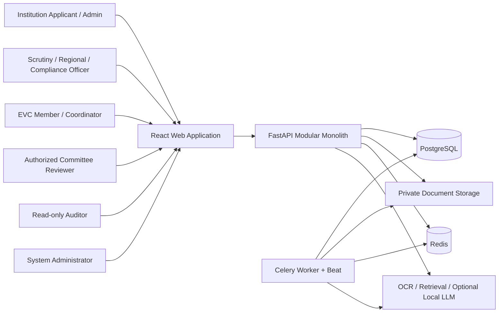
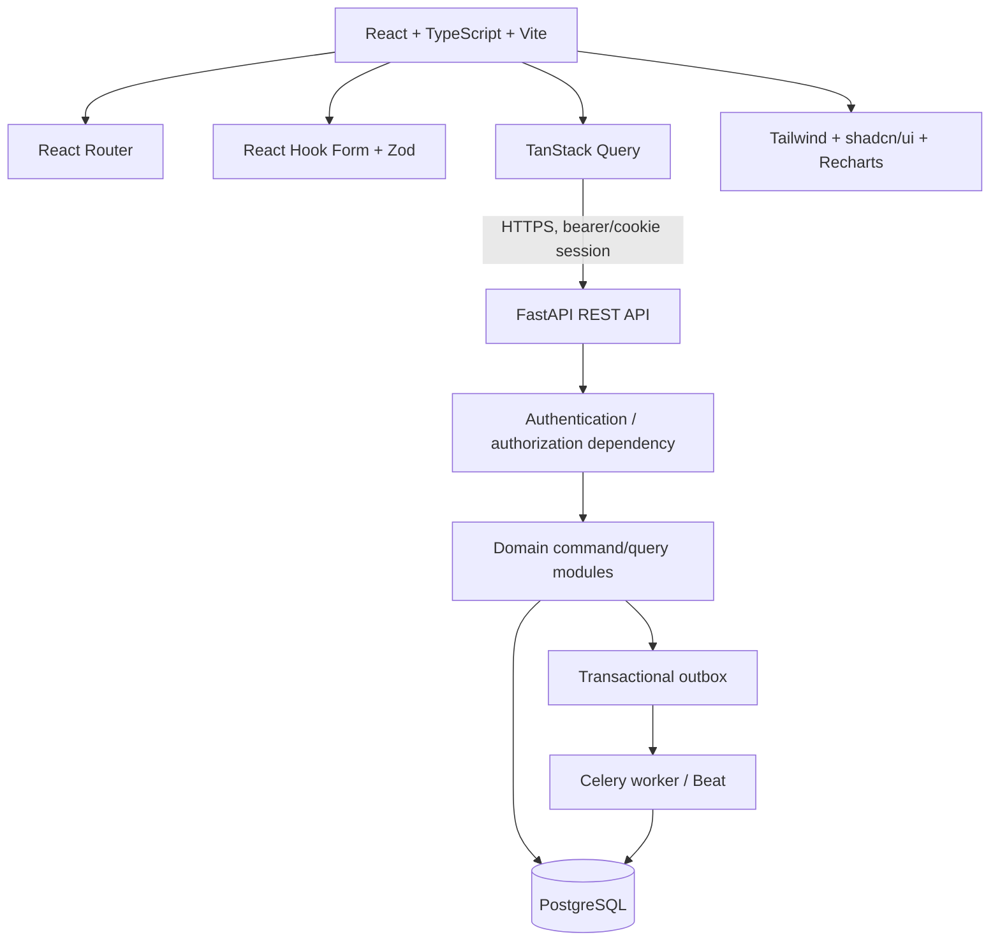
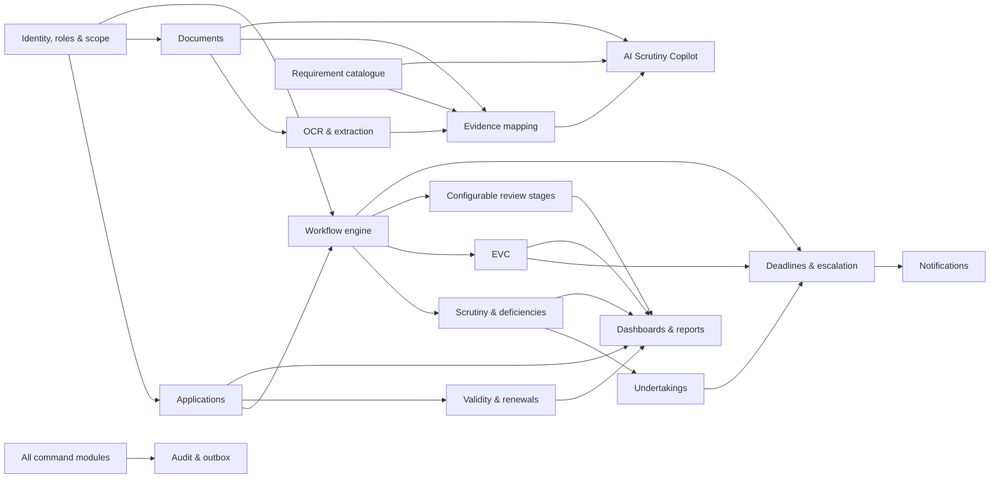

# AICTE FlowTrack — System Overview

## Purpose and scope

AICTE FlowTrack is a **prototype**, modular-monolith platform for handling technical-institution approval applications, scrutiny, deficiencies, EVC coordination, configurable review stages, undertakings, document validity, alerts, reporting, and audit history. It is demonstrable only with synthetic data. It does not connect to AICTE systems and does not assert any official rule, route, deadline, or statutory decision.

Human officers remain the sole authority for every official state transition. The AI Scrutiny Copilot may extract, retrieve, compare, summarize, recommend, and flag; it cannot approve, reject, assign, submit, close, or mutate a business record.

## Architectural principles

1. **Authoritative state in PostgreSQL.** Redis is cache/broker/coordination only.
2. **Backend-enforced authorization.** UI visibility is never an authorization control.
3. **Data-driven workflow.** Versioned workflow definitions, stages, transitions, prerequisites, and escalation policies are data—not controller `if/else` chains.
4. **Human-in-the-loop.** State-changing commands require an authenticated human, a permission check, validation, and an audit event.
5. **Durable side effects.** Transactions write business data, audit events, and an outbox record atomically; workers can safely retry delivery.
6. **Private documents by default.** Files are never served from a public directory and are accessed using an authorization-checked download stream or short-lived private-object-store URL.
7. **Useful without AI.** OCR/embedding/LLM failures degrade to normal document and manual-review workflows.
8. **Prototype honesty.** Every workflow rule and requirement states its source, version, verification status, and synthetic/demo labelling.

## System context

People work through the browser. The API is the policy-enforcement point and persists all official records to PostgreSQL. Workers process database-backed pending work, using Redis only to coordinate Celery. AI services receive only authorized job inputs and return non-binding artifacts.

## Frontend-to-backend architecture

The browser owns only presentation and local form state. TanStack Query treats API responses as server state. Zod validates user experience at the edge, while Pydantic and domain services repeat validation authoritatively on the server. All command endpoints pass through authorization, concurrency, audit, and outbox handling.

## Backend module dependencies

Identity and scoped-access services are foundational. Applications own the approval case; workflow owns its route and transition history; all specialist modules own their own records and request a workflow transition rather than directly setting an application status. Audit and outbox are shared cross-cutting services.

## Bounded modules and ownership

| Module | Owns | Does not own |
|---|---|---|
| Identity and access | users, memberships, roles, scope grants, sessions | application state |
| Institutions and regions | institutions, regions, affiliations | user credentials |
| Applications | application versions, submission snapshot | workflow definitions |
| Workflow | template versions, instances, stage/transition history | specialist review records |
| Documents | blobs, document versions, metadata/access grants | legal determination of validity |
| Scrutiny/deficiencies | assignments, reviews, deficiencies/corrections | application routing |
| EVC/reviews | visits, outcomes, configurable panel reviews | system authorization |
| Requirements/evidence | versioned passages, applicability and evidence links | source document blobs |
| Undertakings/validity | commitments, verification and expiry records | notifications |
| Deadline/notifications | deadlines, policies, notification attempts | business-state transition rules |
| Copilot | prompts, retrieval citations, non-binding outputs | official decisions |
| Audit/operations | immutable-style event log, health/diagnostics | mutable business data |

## Key interaction: a state-changing command

1. API authenticates the user and calculates role plus record scope.
2. The domain service loads the record with a row-version check and verifies permission, ownership, transition rule, prerequisites, and required human review records.
3. In one PostgreSQL transaction it persists the change, workflow history, audit event, and outbox messages.
4. It returns the committed representation. A worker later claims the outbox message, delivers a notification or starts background processing, and records attempts durably.

## Explicit non-goals for Phase 1

- No production deployment, official AICTE integration, payment processing, or legal/statutory-rule engine.
- No automatic approval/rejection, silent workflow transition, or AI-generated determination.
- No full frontend implementation; this phase defines its screens and contracts.

## Phase 2 implementation sequence

1. Bootstrap Docker Compose, FastAPI, React/Vite strict TypeScript, linting, and CI checks.
2. Build migrations and seed synthetic regions, institutions, roles, handbook passages, and labelled demo route templates.
3. Implement identity/scoped RBAC, audit/outbox, document storage adapter, application commands, and data-driven workflow evaluation.
4. Add scrutiny/deficiencies, EVC, undertaking/validity, notification/deadline jobs, and dashboard query projections.
5. Add OCR/evidence mapping and the citation-only Copilot behind feature flags.
6. Build the specified frontend routes, then unit, integration, contract, and Playwright end-to-end coverage.

## Unresolved decisions requiring product owner input

- Identity provider choice and whether MFA/SSO is mandatory for the demonstration.
- Retention, legal hold, residency, malware scanning, and encryption-key-management policy.
- Verified source documents and authority to encode any real routes, deadlines, or requirements.
- Accepted outbound channels (email, SMS, in-app only) and a sanctioned provider.
- EVC scheduling constraints, regional delegation policy, and report/export templates.
