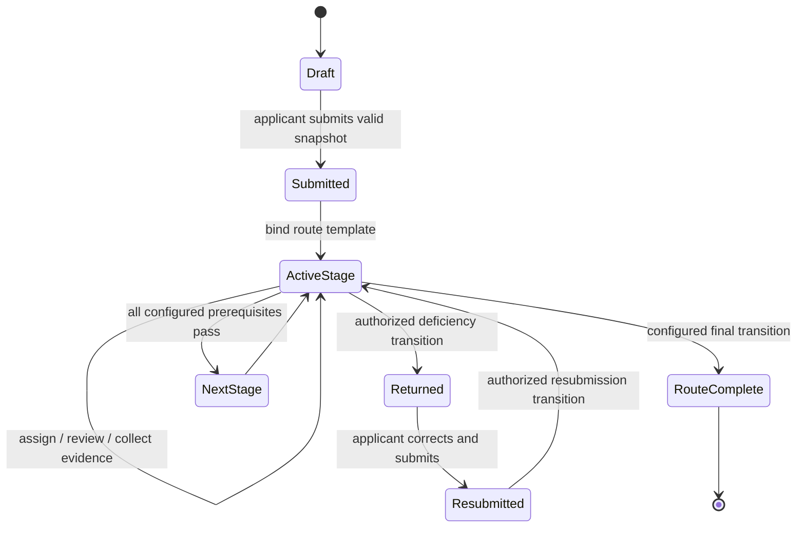

# Data-Driven Workflow Engine

## Step 5 committee lifecycle foundation

Applications remain pinned to their workflow template version and transitions are evaluated server-side against persisted stages, roles, permissions and prerequisites. Migration `0013_committee_reviews` introduces committee-review, member-assignment and individual-submission records. Committee recommendations are distinct from an authorized workflow transition or final decision; SAC/SHC remain configurable synthetic labels pending verified source definitions.

## Model

A `workflow_template_version` has a route type, effective date range, source provenance, verification state, stages, transitions, prerequisite expressions, role grants, deficiency paths, and escalation-policy references. Submission binds an application to exactly one immutable template version. Later template publication never changes an in-flight case unless an authorized, audited migration command creates a new binding.

All shipped prototype routes are labelled `SYNTHETIC_CONFIGURATION` until a verified source document, passage, version, and reviewer approval are recorded. The engine does not claim that any route is officially permitted.

| Prototype route name | Ordered stages |
|---|---|
| `SCRUTINY_ONLY` | submitted → scrutiny → completed |
| `SCRUTINY_THEN_EVC` | submitted → scrutiny → EVC → completed |
| `EVC_THEN_SAC_SHC` | submitted → EVC → SAC/SHC → completed |
| `SCRUTINY_EVC_SAC_SHC` | submitted → scrutiny → EVC → SAC/SHC → completed |
| `CUSTOM` | administrator-configured valid stage graph |

`completed` means the configured route has concluded; it is not an approval/rejection label. Any official determination remains a separately authorized human record when requirements are verified.

## Phase 3 synthetic scrutiny implementation

The prototype persists a reviewer-owned scrutiny review plus structured findings (`ADEQUATE`, `INADEQUATE`, or `CLARIFICATION_REQUIRED`). A configured `return_for_correction` transition requires a documented reason and one or more stable deficiency records. An applicant can add immutable corrective-response records (optionally referencing a private document) and only the configured `resubmit_after_correction` transition returns a case to scrutiny after every deficiency is answered. These are synthetic route behaviors, not AICTE policy assertions.

## Core schema

```json
{
  "template_version": "uuid",
  "source": {"status": "SYNTHETIC_CONFIGURATION", "document_version_id": null},
  "stages": [{"key": "scrutiny", "ordinal": 20, "entry_prerequisites": ["application.submitted"]}],
  "transitions": [{
    "key": "complete_scrutiny",
    "from": "scrutiny",
    "to": "evc",
    "authorized_permissions": ["workflow.transition"],
    "authorized_roles": ["SCRUTINY_OFFICER"],
    "required_facts": ["scrutiny.review.completed", "deficiency.none_open"],
    "on_blocked": "Explain each unmet fact",
    "escalation_policy_key": "review_due_soon"
  }]
}
```

Prerequisites are a small allow-listed expression language, not arbitrary code: boolean `all/any/not`, facts supplied by registered evaluators, comparison to typed values, and a document/evidence count predicate. Each fact evaluator identifies its module, query, and human-readable failure message.

## Transition evaluation and execution

1. Caller requests a named transition with aggregate `version` and optional comment.
2. Engine loads the bound template version and current stage under lock.
3. It checks transition existence, source stage, effective status, principal role/scope/assignment, all required facts, blocking conditions, and required acknowledgement/comment fields.
4. It returns an explanation containing `allowed`, `reasons`, `required_actions`, and `evidence_links`; the preview does not mutate state.
5. An authorized execution repeats evaluation inside the transaction, records `workflow_transition`, moves the instance, emits audit/outbox events, and creates deadlines for the new stage.

The evaluator is also available as `GET /applications/{id}/transition-options`; this makes a disabled UI button explainable but never trusts the UI result.

## Application lifecycle



Draft edits are mutable by eligible applicants. Submission captures a versioned snapshot. Each later stage change is a named transition governed by the bound template. `RouteComplete` does not represent an unverified official outcome.

## Deficiency return and resubmission

```mermaid
sequenceDiagram
  participant SO as Scrutiny Officer
  participant API as API/Workflow
  participant DB as PostgreSQL
  participant IA as Institution Applicant
  SO->>API: create deficiency + request return
  API->>DB: validate assignment, write deficiency/review/audit/outbox
  API->>DB: execute configured return transition
  API-->>IA: durable in-app notification
  IA->>API: upload correction + response
  API->>DB: version documents and link response
  SO->>API: verify response + request resubmission transition
  API->>DB: check configured facts; transition or explain block
```

Deficiencies have stable IDs, severity, requirement/source reference, clear correction request, due date policy, lifecycle state, and all response versions. A return transition opens one or more deficiencies but never deletes prior scrutiny evidence. Resubmission requires the template's configured evidence and authorized verification; it may return to the same or earlier stage only through explicitly configured paths.

## Template governance and safety

- Template edits create a new draft version. Publishing requires `workflow-template.manage`, source metadata, validation of graph reachability/no dangling transition, and audit record.
- Active instances reference immutable versions. A migration displays before/after route and requires a reason; it is a privileged, audited operation.
- The engine rejects unreachable required stages, duplicate ordinals, cycles without an explicit loop limit, absent authorized roles, unsatisfiable prerequisites, and ambiguous same-key transitions.
- Configured escalation never changes approval state. It creates a notification/task/escalation record only.
- “Approve” and “reject” are not implicit engine transition names. If later authorized, they require a separately verified policy/template and explicit human decision record.
